# Java 并发面试题总结：JMM、锁、线程池、AQS 与虚拟线程(1)
# 线程
## ⭐️什么是线程和进程?
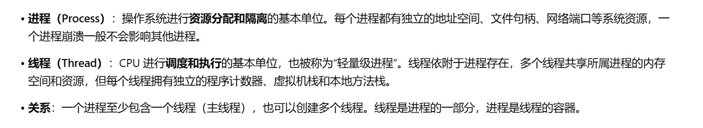
## Java 线程和操作系统的线程有啥区别？
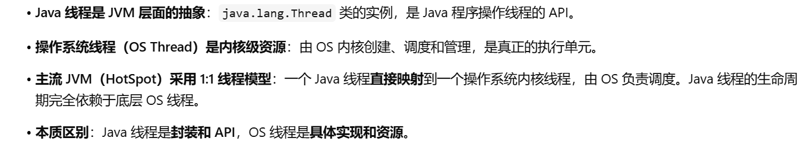
## ⭐️说说线程的生命周期和状态?
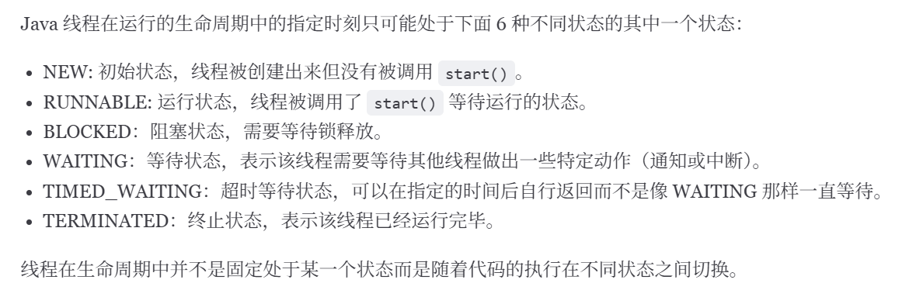
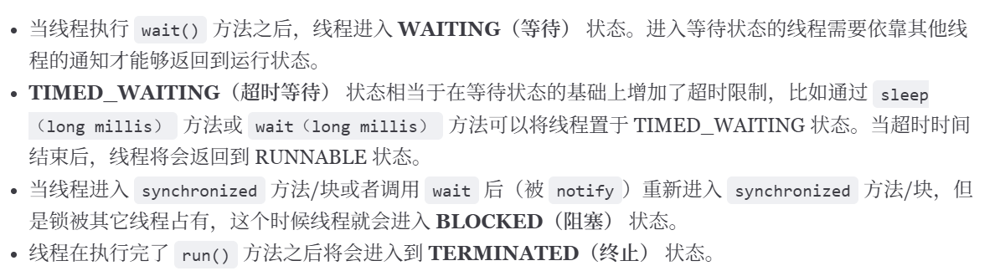
## 什么是线程上下文切换?
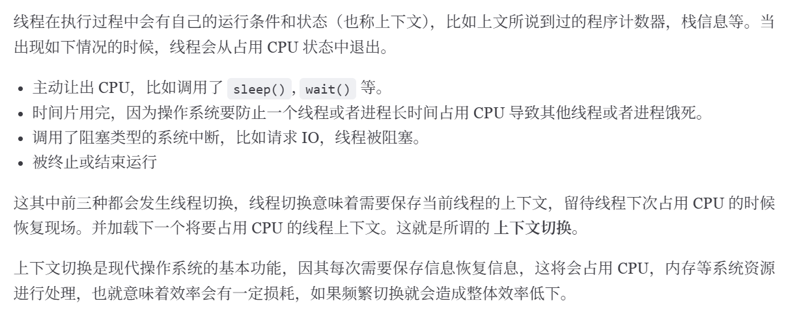
## Thread#sleep() 方法和 Object#wait() 方法对比
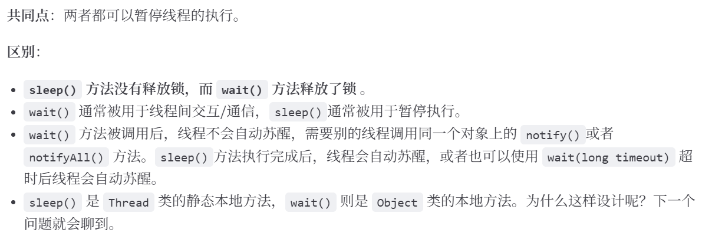
## 为什么 wait() 方法不定义在 Thread 中？
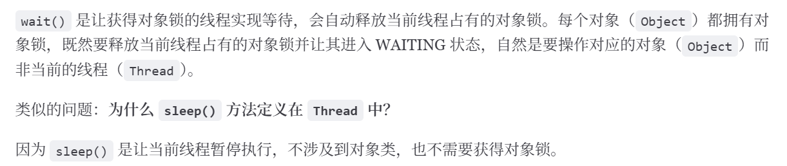
## 可以直接调用 Thread 类的 run 方法吗？
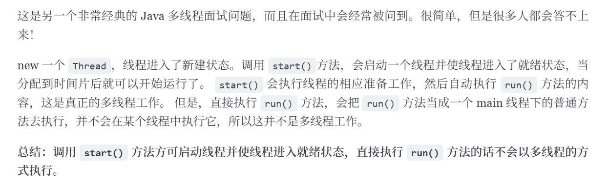
# 多线程
## 并发与并行的区别
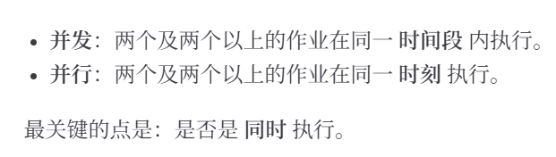
## 同步和异步的区别
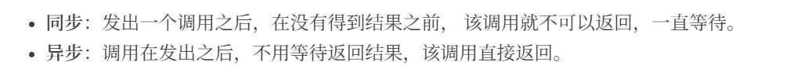
## ⭐️为什么要使用多线程?
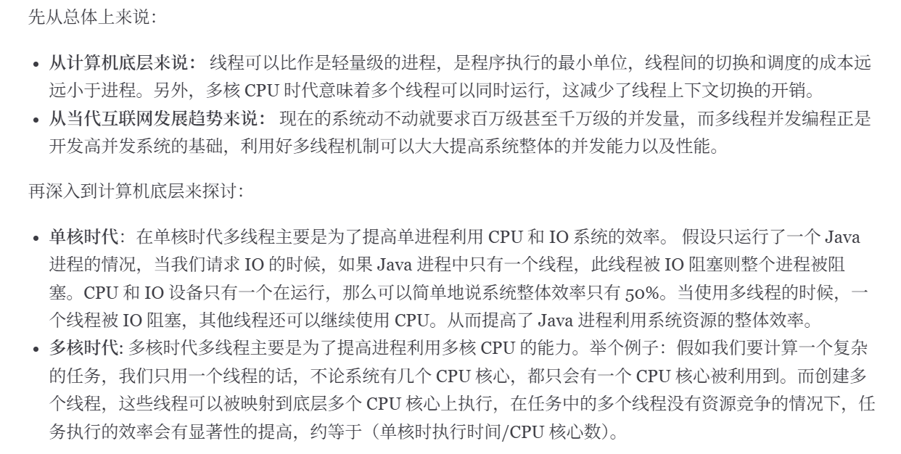
## ⭐️单核 CPU 支持 Java 多线程吗？
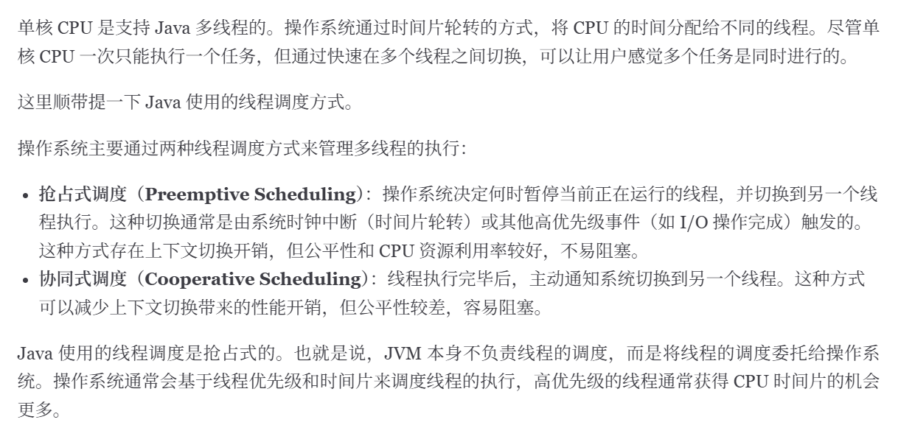
## ⭐️单核 CPU 上运行多个线程效率一定会高吗？
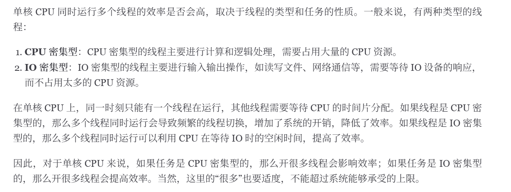
## 使用多线程可能带来什么问题?
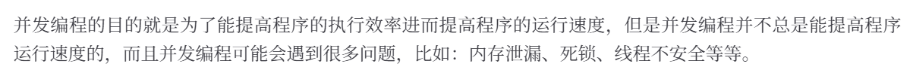
## 如何理解线程安全和不安全？
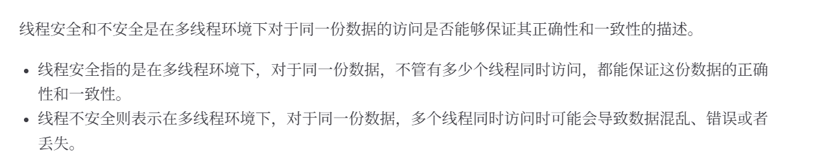
# ⭐️死锁
## 线程死锁的四个必要条件
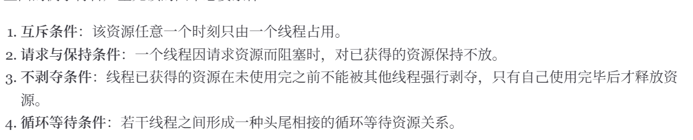
## 如何检测死锁
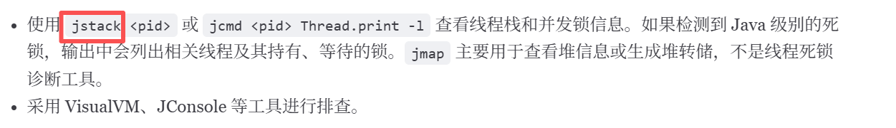
## 如何预防和避免线程死锁?
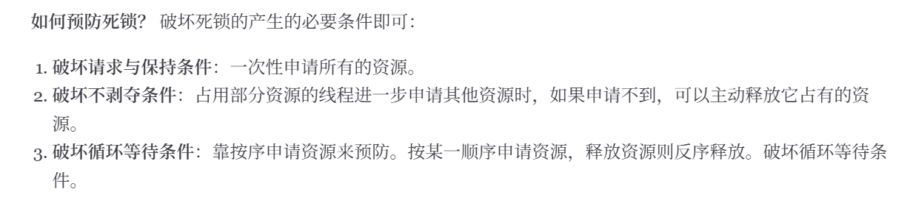
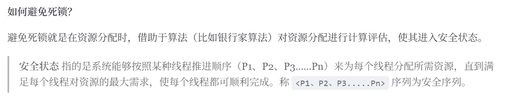